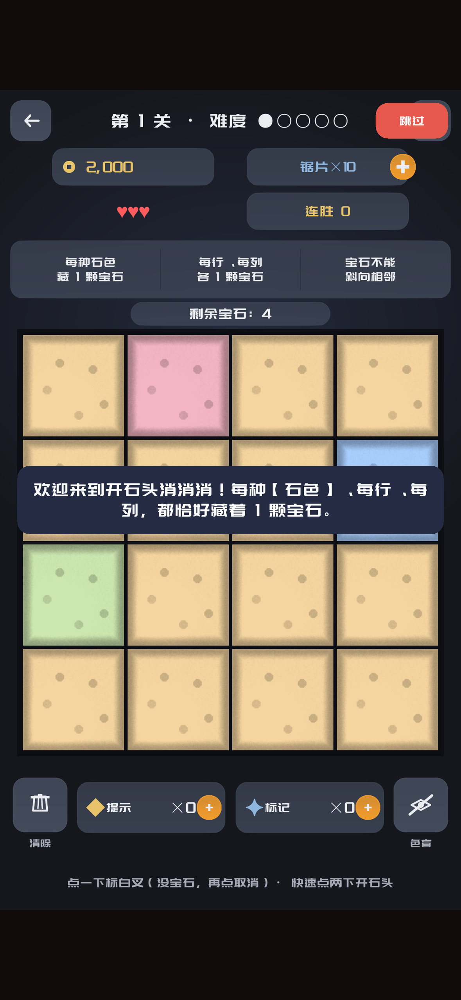
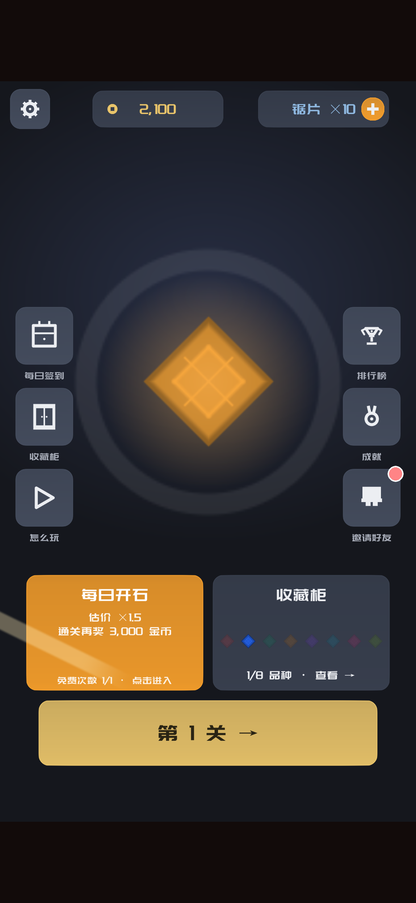
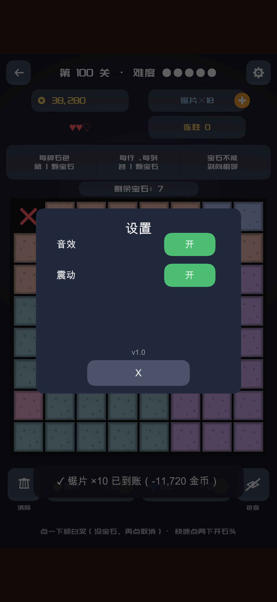
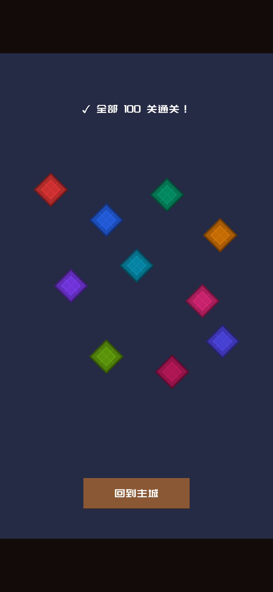

# 《开石头消消消》（StoneCrush）

开石鉴宝 × 数独解谜：100 个唯一解关卡、五档难度、锯片/现金双货币、珠宝收藏柜。单机、无需登录、进度保存在本机。

## 玩法

- **开石**：每块原石都是数独题，切中高价值宝石才有收益
- **100 关**：从新手矿坑到珠宝收藏柜，五档难度
- **双货币**：锯片用于开石，现金用于升级
- **收藏**：翡翠、红宝石、蓝宝石、钻石逐级解锁

## 截图

| | |
|---|---|
|  |  |
|  |  |

## 下载

App Store（审核中）：https://apps.apple.com/app/id6825099015

TestFlight 公测：https://testflight.apple.com/join/GtaByxr8

Android 测试版（侧载）：[StoneCrush-1.0.apk](download/StoneCrush-1.0.apk)


## 支持

- 支持邮箱：learndevelop@163.com
- 隐私政策：https://zhangxinshi.github.io/stonecrush/privacy
- 更新日期：2026-10-21

## 说明

- 游戏含广告与内购，具体以商店页为准
- 适龄提示：12+
- 产品名/商标/隐私政策以正式上架版本为准

## Android 测试版安装

1. 下载 [StoneCrush-1.0.apk](download/StoneCrush-1.0.apk)
2. 允许浏览器/文件管理器“安装未知应用”
3. 安装后首次启动可能需要网络加载广告

```text
版本：1.0
大小：28.37MB
SHA256：ae8f7f0b4dbb767c9e09ab493f5e76a1915a8d781da9c48dcf78339e78de2cb4
```

> 当前为 Android 侧载测试包，非 Google Play 上架；广告为测试配置。
